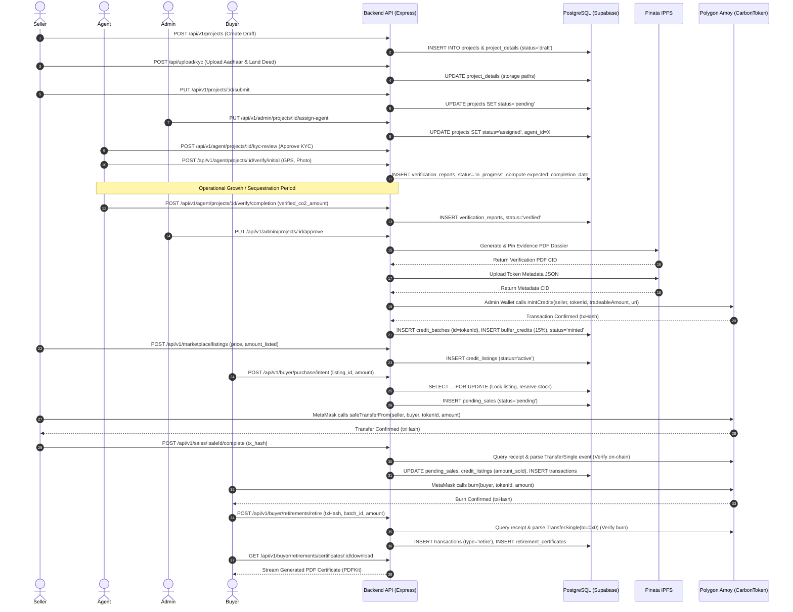
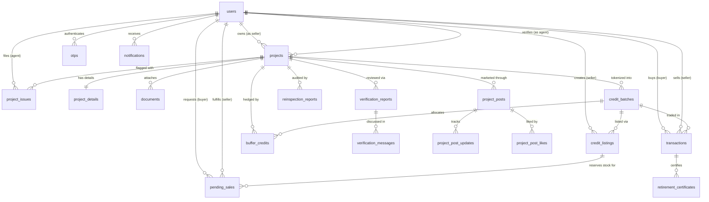
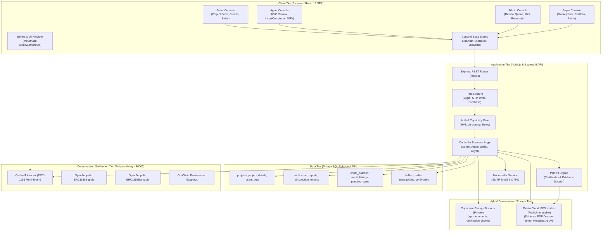

# CarbonXPlanet: Complete Project Technical Documentation & Architecture Specification

**System Name:** CarbonXPlanet — Blockchain-Based Blue Carbon Credit Verification and Tokenization System  
**Repository Name:** `carbonxchanges`  
**System Role:** Senior Full-Stack Developer & Blockchain Systems Architect Evaluation  
**Document Classification:** Definitive Engineering and Architectural Specification  
**Verification Standard:** Strict Verification Against Repository Source Code and Configuration  

---

## Executive Summary & Architectural Overview

CarbonXPlanet (`carbonxchanges`) is an enterprise-grade, decentralized environmental finance platform engineered to verify, tokenize, trade, and retire ecological carbon credits—with special architectural support for blue carbon ecosystems (e.g., mangrove restoration, marine wetlands, coastal conservation) as well as terrestrial forestry, soil carbon, methane capture, and renewable energy.

The platform provides end-to-end Measurement, Reporting, and Verification (MRV) integrity by tightly coupling:
1. **A relational database state machine** (PostgreSQL on Supabase) governing user access, multi-step ecological project registration, lifecycle transitions, and marketplace listings.
2. **Dual-tier off-chain storage**: Confidential KYC identification documents and agent field photos stored in access-controlled Supabase Storage buckets with short-lived time-limited signed URLs, alongside permanent content-addressed decentralized storage (IPFS via Pinata) for public metadata and immutable verification dossier PDFs.
3. **An EVM-compatible Semi-Fungible Smart Contract** (`CarbonToken.sol` based on the ERC-1155 standard) deployed on the **Polygon Amoy Testnet (Chain ID: 80002)**, where each distinct verified project and vintage year constitutes an immutable, independently audited on-chain token class.
4. **An atomic two-phase marketplace settlement architecture** featuring pessimistic row locking (`SELECT ... FOR UPDATE`), escrow stock reservation, on-chain peer-to-peer credit transfers via Web3 wallets (MetaMask), backend event receipt log verification, and on-chain token burning for permanent, double-count-proof credit retirement.

---

## 1. Project Overview

### 1.1 Problem Statement
The global voluntary carbon market (VCM) has historically suffered from critical systemic vulnerabilities:
- **Double Counting & Double Selling:** The same carbon reduction claims sold to multiple counterparties or counted simultaneously by host governments and private buyers.
- **Opacity in MRV (Measurement, Reporting, and Verification):** Disconnect between paper-based certificates issued by registries and physical reality on the ground.
- **Reversal Vulnerabilities:** Physical reversal of carbon sequestration (e.g., forest fires, mangrove die-off, illegal logging) leaving buyers holding worthless or fraudulent paper offsets.
- **High Intermediary Margins:** Brokers, intermediaries, and administrative registries extracting substantial commissions, preventing indigenous and local coastal communities (the actual carbon stewards) from receiving equitable climate finance.
- **Lack of Provenance:** Bundling diverse carbon credits into generic, fungible pools where the specific geographic location, ecological methodology, vintage year, and field verification evidence cannot be audited by the end purchaser.

### 1.2 Objectives
CarbonXPlanet solves these challenges by establishing:
- **Decentralized Provenance:** Storing individual project and vintage attributes directly on-chain using the ERC-1155 multi-token standard.
- **Two-Stage On-Site Verification:** Enforcing independent accredited agent verification across both initial baseline assessment and final post-implementation completion monitoring before a single credit can be minted.
- **Automated Reversal Insurance Buffer:** Automatically sequestering a non-tradeable buffer pool (default 15%) from every verified credit batch to absorb detected permanence reversals without confiscating or deflating buyers' holdings.
- **Cryptographic Retirement Proofs:** Requiring buyers to burn tokens on-chain to an unspendable null address (`0x0000000000000000000000000000000000000000`), automatically triggering verified digital PDF retirement certificates with verifiable PolygonScan transaction hashes.

### 1.3 Core Operating Principles
The platform functions as a four-role coordinated workflow connecting **Sellers** (project developers/landowners), **Field Verification Agents** (independent auditors), **Platform Administrators** (regulatory oversight and contract controllers), and **Buyers** (corporations and individuals pursuing net-zero compliance and voluntary ESG offsets).

---

## 2. Technology Stack & Architectural Trade-off Analysis

The platform is constructed as a decoupled three-tier system: a Single Page Application (SPA) frontend, a stateless RESTful Node.js/Express backend API, and a Solidity smart contract suite on Polygon.

### 2.1 Technology Stack Summary

| Layer | Confirmed Technology | Version / Configuration | Purpose in System |
| :--- | :--- | :--- | :--- |
| **Frontend Framework** | React.js | `^19.2.8` | Component-based interactive UI with concurrent rendering |
| **Frontend Tooling** | Vite | `^8.2.0` | Ultra-fast HMR and optimized production bundling |
| **Styling** | Tailwind CSS | `^4.3.3` (`@tailwindcss/vite`) | Utility-first responsive design and design-system styling |
| **Routing** | React Router DOM | `^7.18.2` | Client-side routing, route loaders, and role-based route guards |
| **State Management** | Zustand | `^5.0.14` | Micro store management (`useAuthStore`, `useBuyerStore`, `useSellerStore`) |
| **HTTP Client** | Axios | `^1.19.0` | Backend API communication with JWT interceptors & token refresh logic |
| **Web3 & Blockchain Client** | Ethers.js | `^6.17.0` | Client-side MetaMask provider interaction and on-chain contract calls |
| **Geospatial Mapping** | Leaflet & React-Leaflet | `^1.9.4` / `^4.2.1` | Project centroid and field coordinate visualization |
| **Biometric / KYC Camera** | React-Webcam | `^7.2.0` | Live webcam image capture for site and identity verification |
| **Notifications & UX** | React Hot Toast / Motion / Lucide / React Icons | `^2.6.0` / `^13.0.0` / `^5.7.0` | Interactive notifications, SVG iconography, and layout animations |
| **Backend Runtime** | Node.js | `>= 18.0.0` | Event-driven asynchronous JavaScript backend execution |
| **Backend Framework** | Express.js | `^5.2.1` | RESTful API routing, middleware pipeline, and controller architecture |
| **Relational Database** | PostgreSQL via Supabase | PostgreSQL 15+ (`pg ^8.22.0`) | Primary relational data store, relational integrity, row-level locks |
| **Connection Pooler** | Pg Pool / Supabase Pooler | AWS ap-southeast-2 (Port 5432 / 6543) | SSL connection pooling (`rejectUnauthorized: false`) |
| **Authentication & Tokens** | JSON Web Tokens & BcryptJS | `jsonwebtoken ^9.0.3`, `bcryptjs ^3.0.3` | Access tokens (7d), HttpOnly refresh cookies (30d), token versioning |
| **Rate Limiting** | Express Rate Limit | `^8.6.1` | Tiered anti-brute-force protection for login, OTP, writes, and purchases |
| **File Handling** | Multer | `^2.2.0` | Multipart memory-storage file uploads without writing to server disk |
| **Decentralized Storage (IPFS)** | Pinata IPFS SDK & REST API | `@pinata/sdk ^2.1.0` / Pinata Cloud | Pinned immutable ERC-1155 token metadata JSON and evidence PDF dossiers |
| **Secure Private Object Storage** | Supabase Storage Service | `@supabase/supabase-js ^2.112.3` | Private KYC document buckets (`kyc-documents`, `verification-photos`) |
| **PDF Generation Engine** | PDFKit | `^0.19.1` | In-memory streaming generation of retirement certificates and verification dossiers |
| **Transactional Email** | Nodemailer | `^9.0.3` (Gmail SMTP) | Dispatching 6-digit verification OTPs and credential notifications |
| **Smart Contract Language** | Solidity | `^0.8.24` (Cancun EVM target) | ERC-1155 token implementation, minting authorization, and burn logic |
| **Blockchain Network** | Polygon Amoy Testnet | Chain ID: `80002` | High-throughput, low-fee Proof-of-Stake EVM testnet |
| **Development Environment** | Hardhat | `^2.22.0` (`@nomicfoundation/hardhat-toolbox`) | Smart contract compilation, testing, gas optimization, deployment scripts |
| **Hosting & Deployment** | Vercel (Frontend) / Production API | `vercel.json` SPA rewrites | Production static edge serving and cloud backend execution |

---

### 2.2 Technology Selection Rationale & Comparative Evaluation

```
+-----------------------------------------------------------------------------------------------------+
|                                 CarbonXPlanet Architecture Stack                                    |
+-----------------------------------------------------------------------------------------------------+
|  Frontend: React 19 + Vite + Tailwind CSS 4 + Zustand + Ethers.js v6 + React-Leaflet + Web3 Wallets |
+-----------------------------------------------------------------------------------------------------+
                                               | HTTP / HTTPS (REST) + WithCredentials Cookie
                                               v
+-----------------------------------------------------------------------------------------------------+
|  Backend: Express 5 + Rate Limiters + JWT Versioning + Multer Memory + PDFKit + Nodemailer (SMTP)   |
+-----------------------------------------------------------------------------------------------------+
        |                                      |                                    |
        | SQL Queries (pg Pool)                | Pinata API / Supabase SDK          | RPC Provider / Wallet
        v                                      v                                    v
+------------------------+      +-------------------------------+      +------------------------------+
|   PostgreSQL Database  |      |     Dual Storage Layer        |      |       Polygon Network        |
| - users & roles        |      | 1. Supabase Storage (Private) |      | - Polygon Amoy (ID: 80002)   |
| - projects & details   |      |    - KYC IDs & Land Deeds     |      | - CarbonToken (ERC-1155)     |
| - verification_reports |      |    - Time-limited signed URLs |      | - Minting & Transfers        |
| - credit_batches       |      | 2. Pinata IPFS (Public/CIDs)  |      | - Permanent Burn (Retirement)|
| - listings & sales     |      |    - Token Metadata JSON      |      |                              |
| - buffer_credits       |      |    - Full Evidence Dossier PDF|      |                              |
+------------------------+      +-------------------------------+      +------------------------------+
```

#### A. Frontend: React 19 + Vite 8 vs. Next.js / Angular
- **Why Selected:** React 19 provides concurrent rendering, streamlined hook lifecycles, and rapid client-side rendering for complex interactive dashboard states (multi-step project registration wizards, interactive Leaflet coordinate maps, dynamic photo inspection tools). Vite 8 provides instant Hot Module Replacement (HMR) and optimized Rollup tree-shaking without the server-side rendering (SSR) complexity of Next.js, which would introduce hydration overhead when interacting with non-SSR browser extensions like MetaMask (`window.ethereum`).
- **Trade-offs:** Client-side rendering requires client bundles to load before first paint; initial SEO is mitigated via Open Graph meta endpoints (`/v1/share/:id`).

#### B. State Management: Zustand 5 vs. Redux Toolkit
- **Why Selected:** Redux introduces significant boilerplate (actions, reducers, dispatchers). Zustand provides a minimal, hook-based immutable store with zero boilerplate and effortless state persistence across React lifecycles. Separate isolated stores (`useAuthStore`, `useSellerStore`, `useBuyerStore`, `useUIStore`) prevent unnecessary cross-component re-renders.
- **Trade-offs:** Redux has a larger ecosystem of time-travel debugging middleware, but Zustand's simplicity ensures maintainability and lower bundle weight.

#### C. Database: PostgreSQL 15+ (Supabase) vs. MongoDB / NoSQL
- **Why Selected:** Financial credit transactions and lifecycle states demand strict ACID guarantees, foreign key constraints, and relational consistency. Project registration involves one-to-one relations (`projects` to `project_details`), one-to-many verification reports (`verification_reports`), and atomic credit accounting. The platform leverages PostgreSQL row-level locks (`SELECT ... FOR UPDATE`) in `PendingSale.js` and `BufferCredit.js` to mathematically prevent race conditions, double-allocations, and overselling.
- **Trade-offs:** Relational schemas require rigid schema migrations; however, semi-structured methodology-specific metrics (e.g., biomass figures, grid emission factors) are elegantly accommodated using native PostgreSQL `JSONB` columns (`methodology_specific_data`).

#### D. Blockchain: Polygon Amoy Testnet (Chain ID 80002) vs. Ethereum Mainnet / Solana
- **Why Selected:** Polygon Amoy provides full Ethereum Virtual Machine (EVM) equivalence, sub-second block times, and negligible transaction fees (fractions of a cent paid in testnet POL/MATIC). Operating on Ethereum Layer 1 would incur prohibitive gas fees ($5–$50 per mint or retirement), pricing out small-scale blue carbon projects. Solana lacks native EVM tooling and standard OpenZeppelin audited ERC-1155 contract primitives.
- **Trade-offs:** Polygon is an Layer 2 / sidechain ecosystem with validator bridge assumptions, but its EVM compatibility ensures frictionless porting to Ethereum Mainnet or Arbitrum/Optimism if enterprise rollup settlement is desired.

#### E. Token Standard: Semi-Fungible ERC-1155 vs. ERC-20 vs. ERC-721
- **Why Selected:** A traditional ERC-20 token is purely fungible—1 token equals 1 token, erasing the origin, location, vintage year, and verification evidence once mixed in a wallet. Conversely, pure ERC-721 NFTs represent strictly indivisible single items, requiring 1,000 separate tokens for 1,000 credits, resulting in massive gas overhead. ERC-1155 represents **semi-fungible batches**: a single contract address manages infinite token IDs (`tokenId`), where each `tokenId` represents a specific project and vintage year (e.g., Token ID #1 = Mangrove Restoration 2026), but within that ID, balances are divisible and fungible (e.g., 5,000 tCO2e).
- **Trade-offs:** ERC-1155 requires contract callers to specify `tokenId` along with transfer amounts, but it provides the perfect balance of on-chain provenance and gas-efficient divisible trading.

#### F. Storage Architecture: Dual Pinata IPFS + Supabase Storage vs. Pure IPFS
- **Why Selected:** Pure IPFS is publicly accessible to anyone possessing the Content Identifier (CID). Uploading confidential legal identification (e.g., Indian Aadhaar numbers, private land title deeds) directly to IPFS violates GDPR, Indian Digital Personal Data Protection (DPDP) standards, and general privacy principles. CarbonXPlanet implements a **hybrid security perimeter**:
  1. Confidential KYC documents and site inspection photos are uploaded to private Supabase Storage buckets, retrievable solely by verified administrators and assigned agents via 1-hour time-limited cryptographic signed URLs (`getSignedUrl`).
  2. The finalized public project certification PDF dossier and ERC-1155 token metadata JSON are pinned to Pinata IPFS as content-addressed, tamper-evident CIDs linked directly into the smart contract's `uri(tokenId)`.
- **Trade-offs:** Requires maintaining both Pinata API credentials and Supabase service role keys.

---

## 3. Project Registration Specification

The project registration engine is managed on the frontend by `ProjectFormPage.jsx` and `projectFormConfig.js`, and on the backend by `projectController.js` and `Project.js`. Data is partitioned between core operational attributes (`projects` table) and detailed MRV / KYC data (`project_details` table).

### 3.1 Step 1: Basic Information

| Form Field Name | Display Label | Data Type | Input Widget | Validation Constraints | Database Table | Database Column | Purpose & Architectural Notes |
| :--- | :--- | :--- | :--- | :--- | :--- | :--- | :--- |
| `title` | Project Title | `VARCHAR(150)` | Text Input | Required; Non-empty string | `projects` | `title` | Canonical project name visible across review queues and marketplace. |
| `project_type` | Project Type | `VARCHAR(100)` | Dropdown Select | Required; Must match one of 8 valid enum values | `projects` | `project_type` | Drives dynamic rendering of Step 3 ecological/technical fields. |
| `project_scale` | Project Scale | `VARCHAR(50)` | Dropdown Select | Required; `'small-scale'` or `'large-scale'` | `projects` | `project_scale` | Regulatory categorization (< 15,000 tCO2e/yr is small-scale). |
| `duration_months` | Duration (months) | `INTEGER` | Number Input | Required; Min: 1, Max: 1200 months (100 yrs) | `project_details` | `duration_months` | Project lifespan; used to calculate `expected_completion_date`. |
| `crediting_period_months`| Crediting Period (months)| `INTEGER` | Number Input | Required; Min: 1, Max: 1200 months | `project_details` | `crediting_period_months` | Formal timespan over which verified credits will be issued. |
| `project_start_date` | Project Start Date | `DATE` | Date Picker | Required; Valid ISO date | `project_details` | `project_start_date` | Baseline operational anchor date. |
| `project_summary` | Project Summary | `TEXT` | Textarea | Optional; Up to 5000 characters | `project_details` | `project_summary` | Public overview displayed on marketplace and evidence PDF. |
| `funding_sources` | Funding Sources | `TEXT` | Text Input | Optional | `project_details` | `funding_sources` | Details grants, private capital, or loans received. |
| `publicly_funded` | Publicly Funded | `BOOLEAN` | Checkbox | Boolean flag (default `false`) | `project_details` | `publicly_funded` | Prevents double-claiming under government NDC commitments. |

*Allowed `project_type` enum values:*  
`reforestation`, `afforestation`, `mangrove_restoration`, `redd+`, `soil_carbon`, `renewable_energy`, `methane_capture`, `other`.

---

### 3.2 Step 2: Location & Spatial Data

| Form Field Name | Display Label | Data Type | Input Widget | Validation Constraints | Database Table | Database Column | Purpose & Architectural Notes |
| :--- | :--- | :--- | :--- | :--- | :--- | :--- | :--- |
| `country` | Country | `VARCHAR(100)` | Text Input | Required; Non-empty string | `project_details` | `country` | Sovereign territory of project site. |
| `state_region` | State / Region | `VARCHAR(100)` | Text Input | Optional | `project_details` | `state_region` | State or provincial administrative region. |
| `latitude` | Latitude | `NUMERIC(9,6)` | Number Input | Range: -90.000000 to +90.000000 | `project_details` | `latitude` | GPS latitude of project centroid. |
| `longitude` | Longitude | `NUMERIC(9,6)` | Number Input | Range: -180.000000 to +180.000000 | `project_details` | `longitude` | GPS longitude of project centroid. |
| `total_project_area_hectares` | Total Area (ha) | `NUMERIC(12,2)` | Number Input | Required; Min: 0.01 hectares | `project_details` | `total_project_area_hectares` | Total bounded geographic area. |
| `eligible_area_hectares` | Eligible Area (ha) | `NUMERIC(12,2)` | Number Input | Optional; Min: 0.01 hectares | `project_details` | `eligible_area_hectares` | Net area qualifying for credit generation. |
| `set_aside_conservation_percent`| Set-Aside (%) | `NUMERIC(5,2)` | Number Input | Range: 0.00% to 100.00% (default 10%) | `project_details` | `set_aside_conservation_percent` | Non-crediting conservation and biodiversity buffer zone. |
| `climate_zone` | Climate Zone | `VARCHAR(100)` | Text Input | Optional | `project_details` | `climate_zone` | Köppen climate classification (e.g., Tropical Monsoon). |
| `soil_type` | Soil Type | `VARCHAR(100)` | Text Input | Optional | `project_details` | `soil_type` | Soil taxonomy (e.g., Mangrove peat, Alluvial clay). |
| `hydrology_status` | Hydrology Status | `VARCHAR(100)` | Text Input | Optional | `project_details` | `hydrology_status` | Coastal tidal regime, riverine flood cycle, or water table depth. |
| `land_title_status` | Land Title Status | `VARCHAR(100)` | Text Input | Optional | `project_details` | `land_title_status` | Legal tenure status (e.g., Freehold, Community Title, Lease). |

---

### 3.3 Step 3: Type-Specific Ecological & Technical MRV Data
Stored dynamically as serialized JSON in the `project_details.methodology_specific_data` column.

#### A. Nature-Based / Forestry / Blue Carbon (`mangrove_restoration`, `reforestation`, `afforestation`, `redd+`)
- `dominant_species` (`TEXT`): Scientific names (e.g., *Rhizophora mangle*, *Avicennia marina*).
- `species_type` (`TEXT`): Classification (e.g., Native Broadleaf, Coastal Mangrove).
- `measurement_season` (`TEXT`): Seasonal monitoring window (e.g., Post-Monsoon, Dry Season).
- `above_ground_biomass` (`NUMERIC`, min 0): Total dry above-ground tree/plant biomass (t/ha).
- `below_ground_biomass` (`NUMERIC`, min 0): Root biomass estimated via standard allometric ratios (t/ha).
- `soil_organic_carbon_0_30cm` (`NUMERIC`, min 0): Organic carbon stock in top 30 cm soil layer (tC/ha).
- `soil_organic_carbon_30_100cm` (`NUMERIC`, min 0): Deep soil carbon stock from 30 cm to 100 cm depth (tC/ha).
- `dead_wood_carbon` (`NUMERIC`, min 0): Standing dead trees and fallen logs carbon density (tC/ha).
- `litter_carbon` (`NUMERIC`, min 0): Leaf litter and fine organic debris carbon stock (tC/ha).
- `sampling_plots` (`INTEGER`, min 1): Number of physical georeferenced inventory sample plots.
- `biodiversity_index` (`NUMERIC`, min 0): Shannon-Wiener Diversity Index or species count.
- `uncertainty_percentage` (`NUMERIC`, 0–100): Statistical inventory sampling error percentage.

#### B. Renewable Energy (`renewable_energy`)
- `energy_source_type` (`SELECT`): `solar_pv`, `wind`, `small_hydro`, `biomass`, `geothermal`, `other`.
- `installed_capacity_mw` (`NUMERIC`, min 0.001): Nameplate peak capacity in Megawatts.
- `annual_generation_mwh` (`NUMERIC`, min 1): Anticipated annual electrical output in MWh.
- `grid_emission_factor` (`NUMERIC`, min 0): Displaced regional grid emissions factor (tCO2/MWh).
- `plant_load_factor_percent` (`NUMERIC`, 0–100): Expected capacity utilization ratio.
- `technology_subtype` (`TEXT`): Specific hardware specs (e.g., Monocrystalline bifacial).
- `grid_connectivity` (`TEXT`): On-grid utility interconnection vs. off-grid mini-grid.

#### C. Methane Capture (`methane_capture`)
- `waste_source_type` (`SELECT`): `landfill`, `agriculture`, `coal_mine`, `wastewater`, `livestock`, `other`.
- `waste_volume_tonnes_year` (`NUMERIC`, min 1): Volume of organic waste digested/flared annually.
- `methane_concentration_percent` (`NUMERIC`, 0–100): Percentage of CH4 in biogas inflow stream.
- `destruction_efficiency_percent` (`NUMERIC`, 0–100): Flares/combustion efficiency rating.
- `energy_recovery_mwh_year` (`NUMERIC`, min 0): Power generated from captured methane.
- `capture_technology` (`TEXT`): System architecture (e.g., Enclosed flare, anaerobic digester).

#### D. Soil Carbon (`soil_carbon`)
- `soil_carbon_method` (`TEXT`): Laboratory testing method (e.g., Dry Combustion, Walkley-Black).
- `baseline_soc_tonnes_ha` (`NUMERIC`, min 0): Initial soil organic carbon at baseline.
- `improved_practice` (`TEXT`): Regenerative intervention (e.g., Zero-tillage, biochar, cover cropping).
- `soil_sampling_depth_cm` (`NUMERIC`, min 1): Core extraction depth (e.g., 30 cm, 100 cm).
- `carbon_stock_change_rate` (`NUMERIC`, min 0): Sequestration accrual rate (tC/ha/year).

---

### 3.4 Step 4: Methodology & Carbon Claims

| Form Field Name | Display Label | Data Type | Input Widget | Validation Constraints | Database Table | Database Column | Purpose & Architectural Notes |
| :--- | :--- | :--- | :--- | :--- | :--- | :--- | :--- |
| `technologies_measures_description` | Technologies / Measures | `TEXT` | Textarea | Optional | `project_details` | `technologies_measures_description`| Narrative of restoration interventions. |
| `methodology_applied` | Methodology Applied | `VARCHAR(150)` | Text Input | Required on submit | `project_details` | `methodology_applied` | Formal standard ID (e.g., Verra VM0007, CDM AR-ACM0003). |
| `ghg_sources_included` | GHG Sources Included | `TEXT` | Textarea | Optional | `project_details` | `ghg_sources_included` | CO2, CH4, N2O account boundaries. |
| `baseline_scenario` | Baseline Scenario | `TEXT` | Textarea | Optional | `project_details` | `baseline_scenario` | Counterfactual emission scenario without project. |
| `additionality_demonstration` | Additionality Demonstration | `TEXT` | Textarea | Optional | `project_details` | `additionality_demonstration` | Financial/regulatory barriers proving carbon finance necessity. |
| `sdg_targets` | SDG Targets | `TEXT` | Text Input | Optional | `project_details` | `sdg_targets` | Targeted UN SDGs (e.g., SDG 13, 14, 15). |
| `total_co2_claimed` | Total CO2 Claimed (tCO2e) | `NUMERIC(14,2)` | Number Input | Required on submit; Min: 1 tCO2e | `project_details` | `total_co2_claimed` | Total credit volume claimed by seller. |
| `estimated_vers` | Estimated VERs | `NUMERIC(14,2)` | Number Input | Optional; Min: 1 | `project_details` | `estimated_vers` | Voluntary Emission Reductions forecast. |
| `monitoring_frequency` | Monitoring Frequency | `VARCHAR(100)` | Text Input | Optional | `project_details` | `monitoring_frequency` | Audit schedule (e.g., Annual, Biennial). |
| `responsible_person` | Responsible Institution | `VARCHAR(150)` | Text Input | Optional | `project_details` | `responsible_person` | Chief ecological officer or institutional lead. |
| `stakeholder_consultation_summary` | Stakeholder Consultation | `TEXT` | Textarea | Optional | `project_details` | `stakeholder_consultation_summary` | Summary of FPIC (Free, Prior, and Informed Consent). |
| `grievance_mechanism` | Grievance Mechanism | `TEXT` | Textarea | Optional | `project_details` | `grievance_mechanism` | Dispute resolution channels for local communities. |

---

### 3.5 Step 5: Owner Identity, Legal Title & KYC Uploads

| Form Field Name | Display Label | Data Type | Input Widget | Validation Constraints | Database Table | Database Column | Storage Location & Privacy |
| :--- | :--- | :--- | :--- | :--- | :--- | :--- | :--- |
| `owner_full_name` | Owner Full Name | `VARCHAR(150)` | Text Input | Required on submit | `project_details` | `owner_full_name` | Publicly sanitized; internal verification only. |
| `owner_id_type` | ID Type | `VARCHAR(50)` | Text Input | Required on submit | `project_details` | `owner_id_type` | Aadhaar, National ID, Passport, PAN. |
| `owner_id_number` | ID Number | `VARCHAR(100)` | Text Input | Required on submit | `project_details` | `owner_id_number` | Masked in public API; encrypted in flight. |
| `land_ownership_type` | Ownership Type | `VARCHAR(100)` | Text Input | Required on submit | `project_details` | `land_ownership_type` | Freehold, Leasehold, Customary, State Concession. |
| `aadhaar_doc` | Aadhaar / Gov ID Scan | `FILE` (PDF/Image) | File Upload | Required on submit; Max: 15MB | `project_details` | `aadhaar_doc_path` | **Private Supabase Bucket** (`kyc-documents`). Path stored in DB; viewed only via 1h signed URLs. |
| `land_deed` | Land Deed / Title Proof | `FILE` (PDF/Image) | File Upload | Required on submit; Max: 15MB | `project_details` | `land_deed_path` | **Private Supabase Bucket** (`kyc-documents`). Path stored in DB; viewed only via 1h signed URLs. |
| `live_verification_photo` | Live Site Photo with Owner | `FILE` (Image) | File Upload / Webcam | Required on submit; Max: 15MB | `project_details` | `live_verification_photo_path` | **Private Supabase Bucket** (`kyc-documents`). Path stored in DB; viewed only via 1h signed URLs. |

---

## 4. User Roles & Access Control Matrix

The platform implements a hybrid security model:
1. **System Roles (`user_role` enum):** `user`, `agent`, `admin` (with legacy compatibility for `seller` and `buyer`).
2. **Dynamic Capability Flags (`is_seller`, `is_buyer`):** Any base user can undergo OTP-verified capability upgrades to become a Seller, a Buyer, or both simultaneously.

```
+---------------------------------------------------------------------------------------------------+
|                                 Role-Based Access Control Matrix                                  |
+----------------------+--------------------+--------------------+-------------------+--------------+
| Action / Route       | Seller (is_seller) | Buyer (is_buyer)   | Field Agent       | Admin        |
+----------------------+--------------------+--------------------+-------------------+--------------+
| Register Project     | YES (Draft/Submit) | NO                 | NO                | NO           |
| Edit Draft Project   | YES (Owned only)   | NO                 | NO                | NO           |
| Upload Project Post  | YES (Owned only)   | NO                 | NO                | NO           |
| Assign Agent         | NO                 | NO                 | NO                | YES          |
| Review KYC Documents | NO                 | NO                 | YES (Assigned)    | YES (All)    |
| Initial Verification | NO                 | NO                 | YES (Assigned)    | NO           |
| Completion MRV Check | NO                 | NO                 | YES (Assigned)    | NO           |
| Flag Reversal/Issue  | NO                 | NO                 | YES (Assigned)    | NO           |
| Approve Project      | NO                 | NO                 | NO                | YES          |
| Trigger On-Chain Mint| NO                 | NO                 | NO                | YES (Owner)  |
| Create Listing       | YES (Owned credits)| NO                 | NO                | NO           |
| Purchase Credits     | NO                 | YES (Wallet req)   | NO                | NO           |
| Complete P2P Transfer| YES (MetaMask sign)| NO                 | NO                | NO           |
| Burn & Retire Credits| NO                 | YES (MetaMask sign)| NO                | NO           |
| Download Certificate | NO                 | YES (Retiree only) | NO                | NO           |
| Resolve Reversal     | NO                 | NO                 | NO                | YES (Buffer) |
| Manage Agents & Users| NO                 | NO                 | NO                | YES          |
+----------------------+--------------------+--------------------+-------------------+--------------+
```

### Detailed Role Workflows

#### A. Seller (`is_seller = true`)
- **Responsibilities:** Originates projects, uploads legal land documentation and GPS coordinates, specifies methodologies, claims sequestration metrics, creates marketplace listings for minted credits, and signs on-chain credit transfers to buyers.
- **Enforcement:** Protected by `requireAuth` and `ensureSeller` middleware (`capabilityGate.js`).
- **Key Views:** Seller Dashboard, Project Registration Wizard, My Projects, Issued Credits, Marketplace Listings, Pending Sales Transfer Execution.

#### B. Verification Agent (`role = 'agent'`)
- **Responsibilities:** Conducts rigorous independent MRV audits. Cannot self-register; accounts are provisioned exclusively by platform administrators with auto-generated secure credentials dispatched via SMTP.
- **Workflow:**
  1. Inspects assigned projects in the `assigned` state.
  2. Reviews and approves/rejects uploaded KYC identity documents and land deeds via `/api/v1/agent/projects/:id/kyc-review`.
  3. Conducts initial field inspection, logging verified GPS coordinates (`gps_lat`, `gps_lng`), timestamped photographic proof (`photo_url`), and adjusting the project completion timeline if needed (`overridden_expected_completion_date`). Status transitions to `in_progress`.
  4. Enforces project duration: Completion verification is mathematically locked until the calendar date reaches `expected_completion_date`.
  5. Conducts completion verification, measuring actual physical sequestration and entering the **authoritative verified amount (`verified_co2_amount`)**. This number—**not the seller's claim**—is what the smart contract mints. Status transitions to `verified`.
  6. Conducts periodic post-mint permanence re-inspections (`/reinspect`) on `minted` projects, reporting any observed carbon reversals.

#### C. Platform Administrator (`role = 'admin'`)
- **Responsibilities:** Platform governance, agent provisioning, conflict adjudication, final review queue approval, smart contract ownership, automated minting oversight, and buffer pool reversal cancellation.
- **Workflow:**
  1. Reviews the queue of `verified` projects.
  2. Approves the project via `/api/v1/admin/projects/:id/approve`.
  3. Triggers automated compilation and pinning of the comprehensive verification evidence PDF dossier to Pinata IPFS.
  4. Executes the on-chain minting transaction via the admin wallet (`CarbonToken.mintCredits`), issuing ERC-1155 tokens directly to the seller's connected MetaMask address while reserving the buffer pool.
  5. Manages detected reversals from agent re-inspections, resolving claims by drawing down the project's reserved buffer credits.

#### D. Buyer (`is_buyer = true`)
- **Responsibilities:** Discovers verified projects on the public marketplace, connects an EVM Web3 wallet (MetaMask), submits purchase requests, monitors atomic stock reservations, receives ERC-1155 tokens upon seller transfer confirmation, and permanently burns credits on-chain to generate downloadable PDF retirement certificates.

---

## 5. Website End-to-End Workflow



---

## 6. Blockchain & Smart Contract Specification

### 6.1 Network Configuration
- **Blockchain Network:** Polygon Amoy Testnet (Public EVM PoS Testnet)
- **Chain ID:** `80002` (`0x13882`)
- **Native Gas Currency:** POL (formerly MATIC)
- **Public RPC Endpoint:** `https://rpc-amoy.polygon.technology` (Fallback: Alchemy Amoy RPC)
- **Block Explorer:** `https://amoy.polygonscan.com`
- **Compiler Version:** Solidity `0.8.24`
- **EVM Target:** `cancun` (Configured in `hardhat.config.js` to support Cancun opcodes like `MCOPY`)
- **Optimizer:** Enabled, 200 runs

---

### 6.2 Smart Contract Architecture: `CarbonToken.sol`
The contract resides in `blockchain/contracts/CarbonToken.sol`. It inherits from the OpenZeppelin v5.0.2 contracts library:
- `ERC1155`: Core multi-token implementation.
- `ERC1155Burnable`: Enables token holders to permanently destroy credits for retirement.
- `ERC1155Supply`: Tracks on-chain total supply per token ID (`totalSupply(tokenId)`).
- `ERC1155URIStorage`: Enables custom IPFS metadata URIs per token ID.
- `Ownable`: Restricts credit minting exclusively to the platform admin deployer address.

```solidity
// SPDX-License-Identifier: MIT
pragma solidity ^0.8.24;

import "@openzeppelin/contracts/token/ERC1155/ERC1155.sol";
import "@openzeppelin/contracts/token/ERC1155/extensions/ERC1155Burnable.sol";
import "@openzeppelin/contracts/token/ERC1155/extensions/ERC1155Supply.sol";
import "@openzeppelin/contracts/token/ERC1155/extensions/ERC1155URIStorage.sol";
import "@openzeppelin/contracts/access/Ownable.sol";

contract CarbonToken is ERC1155, ERC1155Burnable, ERC1155Supply, ERC1155URIStorage, Ownable {
    mapping(uint256 => uint256) public tokenIdToProjectId;
    mapping(uint256 => uint256) public tokenIdToVintageYear;

    event CreditsMinted(
        uint256 indexed tokenId,
        uint256 indexed projectId,
        uint256 vintageYear,
        address indexed to,
        uint256 amount
    );

    constructor(address initialOwner) ERC1155("") Ownable(initialOwner) {}

    function mintCredits(
        address to,
        uint256 tokenId,
        uint256 amount,
        uint256 projectId,
        uint256 vintageYear,
        string memory tokenMetadataURI
    ) external onlyOwner {
        require(to != address(0), "Cannot mint to the zero address");
        require(amount > 0, "Amount must be positive");
        require(totalSupply(tokenId) == 0, "This tokenId has already been minted");

        tokenIdToProjectId[tokenId] = projectId;
        tokenIdToVintageYear[tokenId] = vintageYear;
        _setURI(tokenId, tokenMetadataURI);

        _mint(to, tokenId, amount, "");

        emit CreditsMinted(tokenId, projectId, vintageYear, to, amount);
    }

    function _update(address from, address to, uint256[] memory ids, uint256[] memory values)
        internal
        override(ERC1155, ERC1155Supply)
    {
        super._update(from, to, ids, values);
    }

    function uri(uint256 tokenId) public view override(ERC1155, ERC1155URIStorage) returns (string memory) {
        return super.uri(tokenId);
    }
}
```

---

### 6.3 Token Identifier & Decimal Scaling Architecture

#### 1. Token ID Mapping
The relational database `credit_batches.id` primary key **directly serves as the on-chain `tokenId`**.
- When a project is approved, `Credit.createPendingBatch(projectId, amount, vintageYear)` executes an SQL insert, obtaining `pendingBatch.id` (e.g., ID `42`).
- The smart contract mints with `tokenId = 42`.
- This unifies off-chain SQL relationships and on-chain token registries without requiring complex lookup tables.

#### 2. Fixed-Point Decimal Scaling
Standard ERC-1155 tokens use non-decimal integer amounts. Because carbon credits are measured in fractional tonnes (e.g., `123.45` tCO2e), the codebase implements a strict 2-decimal fixed-point scale factor:
$$\text{SCALE} = 10^{\text{CREDIT\_DECIMALS}} = 10^2 = 100$$
$$\text{On-Chain Amount} = \text{BigInt}(\text{Math.round}(\text{Human Amount} \times 100))$$

*Code Implementation Evidence:*
- Backend: `backend/services/blockchainService.js` (lines 4–9)
- Frontend ABI: `frontend/src/lib/carbonTokenAbi.js` (lines 16–20)
- Example: A project issuing `1,250.75` tCO2e is represented on-chain as `125075` units. The smallest tradeable increment is `0.01` tCO2e (`1` on-chain unit).

---

### 6.4 Smart Contract Security Guarantees & Functions

1. **Uniqueness & Anti-Inflation Guarantee:**
   `require(totalSupply(tokenId) == 0, "This tokenId has already been minted");`
   Ensures that once a project vintage batch is minted, no party—including the contract owner—can ever inflate the credit supply for that specific batch.
2. **Provenance Provenance Mappings:**
   Public on-chain lookups `tokenIdToProjectId[tokenId]` and `tokenIdToVintageYear[tokenId]` allow any external auditor or explorer to verify project identity and vintage without database access.
3. **P2P Transfer Verification (`verifyPurchaseTransaction`):**
   The seller executes `contract.safeTransferFrom(sellerAddress, buyerAddress, tokenId, onChainAmount, "0x")`. The backend inspects the transaction receipt logs, validating that:
   - Receipt status is `1` (Success).
   - Event name is `TransferSingle`.
   - Log parameters match: `id == tokenId`, `from == sellerAddress`, `to == buyerAddress`, and `value == onChainAmount`.
4. **Non-Custodial Permanent Retirement (`verifyBurnTransaction`):**
   Retirement is executed via OpenZeppelin's `burn(account, id, value)`. OpenZeppelin strictly enforces that only the token holder (or an explicitly approved operator via `setApprovalForAll`) can burn tokens.
   - The contract owner **has no privilege** to burn tokens out of a user's wallet.
   - Burning automatically transfers the tokens to `address(0)` (`0x0000000000000000000000000000000000000000`), removing them from `totalSupply(tokenId)` forever.
   - The backend validates the burn receipt before issuing the official retirement certificate.

---

## 7. IPFS, Decentralized Storage & Hybrid Privacy Model

### 7.1 Hybrid Storage Architecture

```
                                      FILE UPLOADS
                                           |
                   +-----------------------+-----------------------+
                   |                                               |
         Confidential / Sensitive                        Public / Trust Anchor
                   |                                               |
                   v                                               v
        [Supabase Storage Service]                         [Pinata Cloud IPFS]
         (Private S3-Compatible)                        (Content-Addressed Web3)
                   |                                               |
      +------------+------------+                    +-------------+-------------+
      |                         |                    |                           |
  Bucket:                   Bucket:               Artifact:                   Artifact:
`kyc-documents`      `verification-photos`    Verification Dossier PDF    Token Metadata JSON
(Aadhaar/Passports)   (Agent Field Photos)    (Full Evidence Package)      (ERC-1155 Metadata)
      |                         |                    |                           |
      +------------+------------+                    +-------------+-------------+
                   |                                               |
                   v                                               v
        Private Relative Path                            IPFS CID (Content Hash)
      e.g. "17192-abc.pdf" in DB                     e.g. "QmXoypizjW3WknfiJn..."
                   |                                               |
                   v                                               v
        Generated On-Demand                             Referenced On-Chain
     Time-Limited Signed URLs                       `tokenMetadataURI` in contract
   (expires in 300s to 3600s)                       Permanently public on Polygon
```

### 7.2 Storage Buckets & Content Addressing Specifications

| Storage Tier | Service Provider | Bucket / Location | Access Permission | Content Stored | Retention & Privacy Profile |
| :--- | :--- | :--- | :--- | :--- | :--- |
| **Private KYC** | Supabase Storage | `kyc-documents` | Private (No public read) | Owner Aadhaar, PAN, Passports, Land Deeds | Encrypted at rest. Read-access strictly restricted to authenticated Admins and Agents via 1-hour signed URLs. |
| **Private Field** | Supabase Storage | `verification-photos` | Private (No public read) | Agent on-site photos, ground monitoring shots | Private. Prevent geotag and private property scraping. Shared via 5-minute signed URLs in admin/agent views. |
| **Public Showcase**| Supabase Storage | `project-post-media` | Public Read | Seller marketing pictures, community updates | Permanent public CDN URL for marketplace showcase posts. |
| **Evidence Dossier**| Pinata IPFS | Decentralized IPFS nodes | Public Content-Addressed | Comprehensive multi-page PDF verification package | Immutable content hash (CID). Embedded with project MRV data, methodology, and agent findings. |
| **Token Metadata** | Pinata IPFS | Decentralized IPFS nodes | Public Content-Addressed | ERC-1155 token metadata JSON | Immutable CID passed into smart contract `_setURI(tokenId, uri)`. Conforms to OpenZeppelin ERC-1155 standards. |

---

### 7.3 Canonical Evidence Package Generation: `projectPdfService.js`
When an administrator approves a verified project (`approveProject`), the backend dynamically executes `generateAndPinVerificationPdf(project, initialReport, completionReport)`:
1. Compiles an in-memory A4 document using `pdfkit`.
2. Assembles Section 1 (Project Info, centroid GPS, acreage, duration), Section 2 (Methodology, SDG targets), Section 3 (Ecological Baseline / Biomass), Section 4 (Stakeholders & FPIC), Section 5 (Owner & Land Ownership proof), Section 6 (Initial Field Agent Report with GPS and embedded site photo), and Section 7 (Completion Field Agent Report with verified CO2 figure).
3. Concludes with the **Platform Certification Statement**, affirming the document is permanently pinned to IPFS and immutably tied to the on-chain ERC-1155 token.
4. Uploads the raw PDF buffer to Pinata (`/pinning/pinFileToIPFS`).
5. Stores the returned CID in `projects.verification_pdf_ipfs_cid`.
6. Embeds the PDF CID into the token metadata JSON as the token's primary asset and external URL.

---

## 8. Database Architecture & API Catalog

### 8.1 Database Entity-Relationship Diagram (ERD)



---

### 8.2 Database Tables & Schema Specifications

#### 1. `users`
- `id SERIAL PRIMARY KEY`
- `name VARCHAR(100) NOT NULL`
- `email VARCHAR(150) UNIQUE NOT NULL`
- `password_hash VARCHAR(255) NOT NULL` (Bcrypt, cost 10)
- `role user_role NOT NULL DEFAULT 'user'` (`'user'`, `'seller'`, `'buyer'`, `'agent'`, `'admin'`)
- `is_seller BOOLEAN NOT NULL DEFAULT false`
- `is_buyer BOOLEAN NOT NULL DEFAULT false`
- `phone_number VARCHAR(20)`
- `address TEXT`
- `pending_role_request VARCHAR(20)`
- `wallet_address VARCHAR(42) UNIQUE` (MetaMask address)
- `wallet_connected_at TIMESTAMP`
- `token_version INTEGER NOT NULL DEFAULT 0` (Session revocation counter)
- `is_verified BOOLEAN NOT NULL DEFAULT false` (Email OTP verification)
- `created_by INTEGER REFERENCES users(id)` (Admin ID for agent provisioning)
- `created_at TIMESTAMP DEFAULT NOW()`

#### 2. `otps`
- `id SERIAL PRIMARY KEY`
- `user_id INTEGER NOT NULL REFERENCES users(id) ON DELETE CASCADE`
- `otp_code VARCHAR(6) NOT NULL`
- `purpose VARCHAR(30) NOT NULL DEFAULT 'signup'` (`'signup'`, `'reset_password'`, `'role_upgrade'`)
- `expires_at TIMESTAMP NOT NULL` (10-minute expiry)
- `created_at TIMESTAMP DEFAULT NOW()`

#### 3. `projects`
- `id SERIAL PRIMARY KEY`
- `seller_id INTEGER NOT NULL REFERENCES users(id)`
- `agent_id INTEGER REFERENCES users(id)`
- `title VARCHAR(150) NOT NULL`
- `project_type VARCHAR(100) NOT NULL`
- `project_scale VARCHAR(50)`
- `status project_status NOT NULL DEFAULT 'draft'` (`'draft'`, `'pending'`, `'assigned'`, `'in_progress'`, `'verified'`, `'approved'`, `'rejected'`, `'minted'`, `'flagged'`)
- `expected_completion_date DATE` (Sequestration enforcement anchor)
- `agent_review_progress JSONB`
- `kyc_docs_status JSONB` (Aadhaar, land deed, live photo approval status)
- `verification_pdf_ipfs_cid VARCHAR(100)` (Pinata evidence package CID)
- `created_at TIMESTAMP DEFAULT NOW()`
- `updated_at TIMESTAMP DEFAULT NOW()`

#### 4. `project_details`
- `project_id INTEGER PRIMARY KEY REFERENCES projects(id) ON DELETE CASCADE`
- Core spatial & duration fields: `duration_months`, `crediting_period_months`, `project_start_date`, `project_summary`, `funding_sources`, `publicly_funded`, `country`, `state_region`, `latitude`, `longitude`, `total_project_area_hectares`, `eligible_area_hectares`, `set_aside_conservation_percent`, `climate_zone`, `soil_type`, `hydrology_status`, `land_title_status`.
- Methodology fields: `technologies_measures_description`, `methodology_applied`, `ghg_sources_included`, `baseline_scenario`, `additionality_demonstration`, `sdg_targets`, `total_co2_claimed`, `estimated_vers`, `buffer_pool_percent` (DEFAULT 15.00), `monitoring_frequency`, `responsible_person`, `stakeholder_consultation_summary`, `grievance_mechanism`.
- Legal & KYC storage paths: `owner_full_name`, `owner_id_type`, `owner_id_number`, `land_ownership_type`, `aadhaar_doc_path`, `land_deed_path`, `live_verification_photo_path`.
- Dynamic ecological metrics: `methodology_specific_data JSONB`.
- `updated_at TIMESTAMP DEFAULT NOW()`

#### 5. `verification_reports`
- `id SERIAL PRIMARY KEY`
- `project_id INTEGER NOT NULL REFERENCES projects(id) ON DELETE CASCADE`
- `agent_id INTEGER NOT NULL REFERENCES users(id)`
- `report_type VARCHAR(20) NOT NULL` (`'initial'` or `'completion'`)
- `gps_lat NUMERIC(9,6)`
- `gps_lng NUMERIC(9,6)`
- `photo_url VARCHAR(255)` (Supabase storage path)
- `notes TEXT`
- `verified_co2_amount NUMERIC(14,2)` (Authoritative mint volume, set only on completion)
- `submitted_at TIMESTAMP DEFAULT NOW()`

#### 6. `credit_batches`
- `id SERIAL PRIMARY KEY` (Serves directly as the ERC-1155 `tokenId`)
- `project_id INTEGER NOT NULL REFERENCES projects(id)`
- `token_amount NUMERIC(12,2) NOT NULL` (Net tradeable credits minted)
- `vintage_year INTEGER NOT NULL`
- `contract_address VARCHAR(42)` (Polygon contract address)
- `mint_tx_hash VARCHAR(66)` (Polygon transaction hash)
- `minted_at TIMESTAMP DEFAULT NOW()`

#### 7. `credit_listings`
- `id SERIAL PRIMARY KEY`
- `batch_id INTEGER NOT NULL REFERENCES credit_batches(id)`
- `seller_id INTEGER NOT NULL REFERENCES users(id)`
- `price_per_credit NUMERIC(10,2) NOT NULL` (Unit price in INR / fiat / POL)
- `amount_listed NUMERIC(12,2) NOT NULL`
- `amount_sold NUMERIC(12,2) NOT NULL DEFAULT 0`
- `amount_reserved NUMERIC(12,2) NOT NULL DEFAULT 0` (Escrowed for active checkout intents)
- `status listing_status NOT NULL DEFAULT 'active'` (`'active'`, `'cancelled'`, `'sold_out'`)
- `image_url TEXT`
- `created_at TIMESTAMP DEFAULT NOW()`
- `updated_at TIMESTAMP DEFAULT NOW()`

#### 8. `pending_sales`
- `id SERIAL PRIMARY KEY`
- `listing_id INTEGER NOT NULL REFERENCES credit_listings(id)`
- `buyer_id INTEGER NOT NULL REFERENCES users(id)`
- `seller_id INTEGER NOT NULL REFERENCES users(id)`
- `batch_id INTEGER NOT NULL REFERENCES credit_batches(id)`
- `amount NUMERIC(12,2) NOT NULL`
- `price_per_credit NUMERIC(10,2) NOT NULL`
- `status VARCHAR(20) NOT NULL DEFAULT 'pending'` (`'pending'`, `'completed'`, `'rejected'`)
- `tx_hash VARCHAR(66)`
- `created_at TIMESTAMP DEFAULT NOW()`
- `completed_at TIMESTAMP`

#### 9. `transactions`
- `id SERIAL PRIMARY KEY`
- `batch_id INTEGER NOT NULL REFERENCES credit_batches(id)`
- `buyer_id INTEGER REFERENCES users(id)`
- `seller_id INTEGER REFERENCES users(id)`
- `tx_hash VARCHAR(66) NOT NULL`
- `type tx_type NOT NULL` (`'purchase'` or `'retire'`)
- `amount NUMERIC(12,2) NOT NULL`
- `price_per_credit NUMERIC(10,2)` (NULL for retirement)
- `total_price NUMERIC(14,2)` (NULL for retirement)
- `created_at TIMESTAMP DEFAULT NOW()`

#### 10. `retirement_certificates`
- `id SERIAL PRIMARY KEY`
- `transaction_id INTEGER NOT NULL REFERENCES transactions(id)`
- `certificate_pdf_url VARCHAR(255)`
- `burn_tx_hash VARCHAR(66) NOT NULL`
- `retirement_reason TEXT`
- `beneficiary_name VARCHAR(150)`
- `issued_at TIMESTAMP DEFAULT NOW()`

#### 11. `buffer_credits`
- `id SERIAL PRIMARY KEY`
- `project_id INTEGER NOT NULL REFERENCES projects(id)`
- `batch_id INTEGER NOT NULL REFERENCES credit_batches(id)`
- `amount_reserved NUMERIC(14,2) NOT NULL` (15% reserve)
- `amount_cancelled NUMERIC(14,2) NOT NULL DEFAULT 0`
- `status buffer_credit_status NOT NULL DEFAULT 'reserved'` (`'reserved'`, `'partially_cancelled'`, `'depleted'`)
- `created_at TIMESTAMP DEFAULT NOW()`

#### 12. `reinspection_reports`
- `id SERIAL PRIMARY KEY`
- `project_id INTEGER NOT NULL REFERENCES projects(id)`
- `agent_id INTEGER NOT NULL REFERENCES users(id)`
- `gps_lat NUMERIC(9,6)`, `gps_lng NUMERIC(9,6)`
- `photo_ipfs_cid VARCHAR(100)`
- `notes TEXT`
- `reversal_detected BOOLEAN NOT NULL DEFAULT false`
- `reversal_amount NUMERIC(14,2)`
- `resolved BOOLEAN NOT NULL DEFAULT false`
- `resolved_at TIMESTAMP`
- `submitted_at TIMESTAMP DEFAULT NOW()`

#### 13. Auxiliary Tables
- `project_posts`, `project_post_updates`, `project_post_likes` (Public social storytelling)
- `verification_messages` (Audit trail messaging between Agent and Seller)
- `notifications` (User notification bell and dispatch engine)
- `contact_messages` (Public visitor contact requests with status tracking)
- `project_issues` (Project flags submitted by auditing agents)

---

### 8.3 Complete API Route Catalog

#### Shared & Public Authentication Routes (`/api/v1/auth`)
- `POST /signup`: Registers new user, hashes password, generates 6-digit OTP, dispatches email.
- `POST /verify-otp`: Validates OTP against expiration, activates account (`is_verified=true`), generates access JWT.
- `POST /login`: Validates credentials, checks verification status, issues access JWT and sets `httpOnly` refresh cookie.
- `GET /me`: Returns profile of authenticated caller.
- `POST /refresh`: Verifies `httpOnly` refresh cookie, checks `token_version` revocation, issues new token pair.
- `POST /logout`: Bumps user's `token_version` in PostgreSQL (revoking all active tokens), clears cookie.
- `POST /forgot-password`: Generates `reset_password` OTP, dispatches reset email.
- `POST /reset-password`: Validates OTP, updates password hash, revokes existing sessions via `bumpTokenVersion`.

#### Storage & Media Routes (`/api/upload`)
- `POST /kyc`: Multer memory upload for KYC ID, land deeds, and agent photos to private Supabase buckets.
- `POST /media`: Uploads marketing imagery to public Supabase bucket.

#### Seller Operations (`/api/v1/projects`, `/api/v1/credits`, `/api/v1/marketplace`, `/api/v1/sales`)
- `POST /projects`: Creates project draft (`projects` + `project_details`).
- `PUT /projects/:id`: Updates fields of a project in `draft` status.
- `PUT /projects/:id/submit`: Validates all required MRV fields; transitions status to `pending`.
- `GET /projects/mine`: Paginated list of seller's owned projects.
- `GET /projects/:id`: Full details of seller's project.
- `DELETE /projects/:id`: Deletes project (allowed only while in `draft` status).
- `POST /projects/:id/kyc-replace`: Replaces flagged KYC document, resetting status to `pending`.
- `GET /credits/issued`: Returns all minted credit batches for seller's approved projects.
- `GET /credits/balance`: Calculates total minted vs. sold balance.
- `POST /marketplace/listings`: Creates active marketplace listing from an unsold batch.
- `PUT /marketplace/listings/:id/price`: Updates unit price per credit.
- `DELETE /marketplace/listings/:id`: Cancels listing (soft delete).
- `GET /sales/pending`: Returns pending buyer purchase requests requiring transfer fulfillment.
- `POST /sales/:saleId/complete`: Receives seller's MetaMask `tx_hash`, verifies on-chain transfer, updates stock.
- `POST /sales/:saleId/reject`: Rejects sale, releasing escrowed stock back to listing.

#### Agent Operations (`/api/v1/agent`)
- `GET /dashboard`: Overview of assigned, due, and completed audits.
- `GET /projects`: Fetches assigned projects awaiting inspection.
- `GET /projects/due-for-completion`: Filters projects where `CURRENT_DATE >= expected_completion_date`.
- `GET /projects/:id`: Fetches comprehensive project dossier with KYC document signed URLs.
- `POST /projects/:id/kyc-review`: Approves or rejects Aadhaar, Land Deed, or Live Photo.
- `POST /projects/:id/verify/initial`: Logs baseline GPS, field photo, sets completion date; moves to `in_progress`.
- `POST /projects/:id/verify/completion`: Logs completion GPS, field photo, and authoritative `verified_co2_amount`; moves to `verified`.
- `POST /projects/:id/flag`: Flags project issue for admin intervention.
- `POST /projects/:id/reinspect`: Logs post-mint audit, reporting permanence reversals.
- `GET /reports/:reportId/messages` & `POST /messages`: Two-way audit communication with seller.

#### Admin Operations (`/api/v1/admin`)
- `POST /agents`: Creates verified Agent account with auto-generated credentials, sending welcome email.
- `GET /agents` & `GET /agents/:id/workload`: Agent roster and real-time project distribution statistics.
- `GET /projects`: Review queue filtered by status (`pending`, `verified`, `approved`).
- `GET /projects/:id`: Detailed view with signed URLs for KYC documents and agent photos.
- `PUT /projects/:id/assign-agent`: Assigns agent; moves status from `pending` to `assigned`.
- `PUT /projects/:id/remove-agent`: Removes agent; reverts status to `pending`.
- `PUT /projects/:id/approve`: Approves project, pins evidence dossier to IPFS, triggers automated on-chain mint.
- `PUT /projects/:id/reject`: Rejects project; dispatches seller notification.
- `GET /mint/queue`: Queue of approved projects awaiting manual mint retry.
- `POST /mint/:id/retry`: Retries failed automated on-chain minting transaction.
- `GET /reversals/queue`: Unresolved reversal reports submitted by re-inspecting agents.
- `PUT /reversals/:reportId/resolve`: Cancels reversal volume from buffer pool via FIFO algorithm.
- `GET /oversight/users`, `/oversight/projects`, `/oversight/transactions`: System-wide audit logs.
- `GET /messages`, `PATCH /messages/:id/status`, `DELETE /messages/:id`: Public contact inquiry management.

#### Buyer Operations (`/api/v1/buyer`)
- `GET /marketplace`: Public browse of active credit listings with multi-attribute filtering.
- `GET /marketplace/:listingId`: Detailed view of listing, project metrics, and seller identity.
- `POST /purchase/intent`: Submits purchase intent; locks listing row and reserves stock.
- `GET /purchase/intents`: Returns buyer's pending and completed purchase orders.
- `GET /portfolio`: Aggregated credit holdings calculated as total purchased minus total retired.
- `POST /retirements/retire`: Validates on-chain burn transaction hash, decrements portfolio, issues certificate.
- `GET /retirements/certificates`: Returns buyer's issued retirement certificates.
- `GET /retirements/certificates/:id/download`: Streams freshly generated official PDF retirement certificate.

---

## 9. Algorithmic Implementations & Mathematical Logic

### 9.1 Expected Completion Date Calculation
- **Location:** `backend/models/Project.js` (`setExpectedCompletionDate`)
- **Mathematical Formula:**
  $$\text{Expected Completion Date} = \text{Project Start Date} + (\text{Duration Months} \times \text{Interval Month})$$
- **Working Steps:**
  1. Triggered upon project submission.
  2. Executed via PostgreSQL interval arithmetic:
     ```sql
     UPDATE projects p
     SET expected_completion_date = (pd.project_start_date + (pd.duration_months || ' months')::interval)::date
     FROM project_details pd
     WHERE p.id = pd.project_id AND p.id = $1
     ```
  3. Can be overridden during initial field verification if the agent identifies physical delays, provided `overrideDate >= CURRENT_DATE`.
  4. Enforces MRV integrity: `agentVerificationController.js` blocks completion verification if `CURRENT_DATE < expected_completion_date`.

---

### 9.2 Carbon Credit Decimal Scaling Algorithm
- **Location:** `backend/services/blockchainService.js` & `frontend/src/lib/carbonTokenAbi.js`
- **Mathematical Formula:**
  $$A_{\text{on-chain}} = \left\lfloor A_{\text{human}} \times 10^2 + 0.5 \right\rfloor$$
- **Working Steps:**
  1. Accepts human-readable metric tonnes (e.g., `450.25` tCO2e).
  2. Multiplies by scale factor `100`.
  3. Rounds to nearest integer and converts to native JavaScript `BigInt` for transmission to Ethereum ABI serializer.
  4. Prevents floating-point precision leakage across Web3 interfaces.

---

### 9.3 Buffer Pool Allocation & Mint Separation Formula
- **Location:** `backend/controllers/admin/mintController.js` (`attemptMint`)
- **Mathematical Formulation:**
  Let $V$ be the authoritative agent-verified carbon sequestration amount (`verified_co2_amount`), and $B_{\%}$ be the buffer pool percentage (`buffer_pool_percent`, default 15.00%).
  $$A_{\text{buffer}} = \text{round}\left(V \times \frac{B_{\%}}{100}, 2\right)$$
  $$A_{\text{tradeable}} = \text{round}(V - A_{\text{buffer}}, 2)$$
- **Working Steps:**
  1. Admin approves verified project with $V = 1,000.00$ tCO2e and $B_{\%} = 15.00\%$.
  2. Calculates $A_{\text{buffer}} = 150.00$ tCO2e; $A_{\text{tradeable}} = 850.00$ tCO2e.
  3. On-Chain Minting: Calls `CarbonToken.mintCredits` with `amount = toOnChainAmount(850.00) = 85000` units issued to Seller's wallet.
  4. Off-Chain Hedge: Inserts $150.00$ tCO2e into `buffer_credits` table with `status = 'reserved'`.
  5. The buffer pool is **never minted to the seller** and **never listed on the marketplace**.

---

### 9.4 FIFO Reversal Buffer Cancellation Algorithm
- **Location:** `backend/models/BufferCredit.js` (`cancelBufferCredits`)
- **Working Steps:**
  1. When an agent re-inspection identifies an ecological reversal of $R$ tonnes, the admin invokes `/reversals/:reportId/resolve`.
  2. Opens a database transaction and executes a row-locking query:
     ```sql
     SELECT * FROM buffer_credits 
     WHERE project_id = $1 AND status != 'depleted' 
     ORDER BY created_at ASC FOR UPDATE
     ```
  3. Iterates through reserved buffer batches in First-In-First-Out (FIFO) chronological order:
     - For each batch, calculates available volume: $A_{\text{avail}} = A_{\text{reserved}} - A_{\text{cancelled}}$.
     - Determines batch cancellation: $C = \min(A_{\text{avail}}, R_{\text{remaining}})$.
     - Updates database row: $A_{\text{cancelled}} \leftarrow A_{\text{cancelled}} + C$.
     - If $A_{\text{cancelled}} \ge A_{\text{reserved}}$, updates status to `'depleted'`; else `'partially_cancelled'`.
     - Decrements remaining reversal: $R_{\text{remaining}} \leftarrow R_{\text{remaining}} - C$.
  4. Commits transaction. If $R_{\text{remaining}} > 0$ after depleting all project buffer reserves, reports `shortfall = R_remaining` to admin.
  5. **Core Trust Guarantee:** Reversals are absorbed exclusively by the buffer pool; already-purchased buyer holdings are never confiscated or altered.

---

### 9.5 Two-Phase Checkout & Pessimistic Stock Reservation Algorithm
- **Location:** `backend/models/PendingSale.js` (`createPendingSale`, `completePendingSale`, `rejectPendingSale`)
- **Working Steps:**
  1. **Phase 1: Reservation (Buyer Request)**
     - Acquires exclusive row lock: `SELECT * FROM credit_listings WHERE id = $1 FOR UPDATE`.
     - Validates available stock: $\text{Available} = \text{amount\_listed} - \text{amount\_sold} - \text{amount\_reserved}$.
     - Rejects with `INSUFFICIENT_STOCK` (409) if requested amount $> \text{Available}$.
     - Atomically updates listing: `amount_reserved = amount_reserved + amount`.
     - Inserts record into `pending_sales` (`status = 'pending'`).
  2. **Phase 2: Settlement (Seller On-Chain Transfer)**
     - Seller reviews pending sale and executes `safeTransferFrom` via MetaMask.
     - Submits transaction hash to `/complete`.
     - Backend queries blockchain RPC, parses transaction logs, and verifies that the exact token ID and amount were transferred from seller to buyer.
     - Atomically transitions listing: `amount_sold = amount_sold + amount`, `amount_reserved = amount_reserved - amount`.
     - If `amount_sold >= amount_listed`, marks listing as `'sold_out'`.
     - Transitions pending sale to `'completed'`, inserts official row in `transactions`.

---

### 9.6 Portfolio Holdings Calculation Algorithm
- **Location:** `backend/models/Portfolio.js` (`findPortfolioByBuyer`)
- **Mathematical Formula:**
  $$\text{Current Holding}(P, B) = \sum_{T \in \text{Purchases}} T.\text{amount} - \sum_{T \in \text{Retirements}} T.\text{amount}$$
- **SQL Aggregation Logic:**
  ```sql
  SELECT p.id AS project_id, p.title AS project_title, cb.id AS batch_id,
         COALESCE(SUM(t.amount) FILTER (WHERE t.type = 'purchase'), 0) AS total_purchased,
         COALESCE(SUM(t.amount) FILTER (WHERE t.type = 'retire'), 0) AS total_retired,
         (COALESCE(SUM(t.amount) FILTER (WHERE t.type = 'purchase'), 0)
          - COALESCE(SUM(t.amount) FILTER (WHERE t.type = 'retire'), 0)) AS current_holding
  FROM transactions t
  JOIN credit_batches cb ON cb.id = t.batch_id
  JOIN projects p ON p.id = cb.project_id
  WHERE t.buyer_id = $1
  GROUP BY p.id, p.title, p.project_type, cb.id
  HAVING (COALESCE(SUM(t.amount) FILTER (WHERE t.type = 'purchase'), 0)
          - COALESCE(SUM(t.amount) FILTER (WHERE t.type = 'retire'), 0)) > 0
  ```

---

### 9.7 Note on Carbon Sequestration Formulas
*Explicit Architectural Fact:* The repository **does not** contain automated biomass-to-CO2 calculation algorithms or machine learning inference scripts. Carbon sequestration figures are established externally by project developers in accordance with approved methodology protocols (e.g., Verra VCS VM0007, CDM) and verified manually by accredited Field Verification Agents on-site based on field sampling plots.

---

## 10. Security Architecture & Threat Modeling

### 10.1 Authentication & Session Security
- **Bcrypt Password Hashing:** Passwords hashed with salt cost factor 10.
- **Dual-Token Lifecycle:**
  - Short-lived Access Token: Signed with `JWT_SECRET`, valid for 7 days (or 15 min in refresh flow), contains `id`, `email`, `role`, `is_seller`, `is_buyer`, and `tv` (token version).
  - Long-lived Refresh Token: Signed with `JWT_SECRET`, valid for 30 days, transmitted exclusively as an `httpOnly`, `SameSite=Lax` (or `None` in cross-origin production), secure cookie. Inaccessible to JavaScript, neutralizing client-side Cross-Site Scripting (XSS) token theft.
- **Instant Revocation Counter (`token_version`):**
  - Database stores an integer `token_version` on each user row.
  - Every JWT payload encodes the current version (`tv`).
  - `requireAuth` middleware verifies `(user.token_version ?? 0) === (decoded.tv ?? 0)`.
  - Calling `/logout`, changing a password, or resetting credentials increments `token_version`, immediately invalidating all active tokens across all devices.

---

### 10.2 Rate Limiting Architecture (`rateLimiter.js`)
Configured using `express-rate-limit` with standard HTTP headers:
- `loginLimiter`: 20 requests per 15 minutes (100 in dev) to neutralize brute-force credential stuffing.
- `otpLimiter`: 5 requests per 15 minutes to prevent OTP guessing.
- `writeLimiter`: 20 write operations per minute for listings, agent reviews, and document replacements.
- `purchaseLimiter`: 5 purchase requests per minute per IP to prevent marketplace transaction flooding.
- `passwordLimiter`: 5 requests per 15 minutes for credential resets.
- `generalLimiter`: 200 requests per minute platform-wide.

---

### 10.3 Smart Contract & Web3 Security
- **Strict Role Isolation (`Ownable`):** The `CarbonToken.mintCredits` method can only be executed by the authorized platform deployer wallet (`onlyOwner`).
- **Zero-Address Burn Mechanics:** Credit retirement cannot be directed to arbitrary addresses; it must be executed through `burn`, verifying the tokens are sent to `address(0)`.
- **No Force-Burn Privilege:** The contract owner has no override capability to burn tokens from a user's wallet, mathematically guaranteeing non-custodial ownership of purchased credits.

---

### 10.4 Security Defect Analysis & Hardening Recommendations

```
+----------------------------------------------------------------------------------------------------+
|                                    Identified Security Limitations                                 |
+----------------------+--------------------+--------------------------------------------------------+
| Vulnerability Area   | Severity Level     | Description & Mitigation Required                      |
+----------------------+--------------------+--------------------------------------------------------+
| Payment Off-Chain    | HIGH (Functional)  | Purchases reserve stock and verify token transfers,    |
| Settlement Gap       |                    | but fiat/stablecoin payment settlement is handled      |
|                      |                    | off-platform before seller submits transfer tx.        |
|                      |                    | Mitigation: Implement on-chain Atomic Swap Escrow.    |
+----------------------+--------------------+--------------------------------------------------------+
| Missing Function     | MEDIUM (Bug)       | `retirementController.js` calls undefined method       |
| `getHoldingForBatch` |                    | `Portfolio.getHoldingForBatch`. Throws runtime error.  |
|                      |                    | Mitigation: Add and export function in `Portfolio.js`. |
+----------------------+--------------------+--------------------------------------------------------+
| Private Key Hot      | MEDIUM (Key Mgmt)  | Admin private key is stored as plaintext env var in    |
| Storage              |                    | backend `.env`. Compromise permits unauthorized mints. |
|                      |                    | Mitigation: Migrate to AWS KMS / HashiCorp Vault.      |
+----------------------+--------------------+--------------------------------------------------------+
| Single-Signer Admin  | MEDIUM (Governance)| Admin contract owner is a single EOA wallet.           |
|                      |                    | Mitigation: Upgrade owner to Gnosis Safe Multi-Sig.    |
+----------------------+--------------------+--------------------------------------------------------+
```

---

## 11. UI Page Catalog & Component Hierarchy

The frontend architecture implements distinct dashboard shells and shared public views.

### 11.1 Shared & Public Pages (`frontend/src/pages/shared`)
- **`Home.jsx` (`/`):** Hero landing page, real-time statistics counter, live climate articles, interactive carbon impact calculator, featured project cards, and public navigation.
- **`About.jsx` (`/about`):** Platform mission statement, Blue Carbon preservation science, MRV verification explanations, and core contributor information.
- **`Contact.jsx` (`/contact`):** Visitor inquiry form dispatching to `contact_messages` table and alerting support via SMTP email.
- **`MarketplacePage.jsx` (`/marketplace`):** Public browse interface with search, project-type tabs, price sliders, country filters, and grid/list view toggles.
- **`MarketplaceDetailPage.jsx` (`/marketplace/:listingId`):** In-depth project overview, technical MRV metrics, interactive Leaflet coordinate map, social showcase posts, and `PurchaseModal` trigger.
- **`Posts.jsx` (`/posts`) & `PostDetail.jsx` (`/posts/:postId`):** Social showcase posts, photographic timelines, progress updates, and community liking engine.
- **`ProfilePage.jsx` (`/profile`):** User profile editor, capability upgrade triggers, and linked wallet status display.
- **`WalletPage.jsx` (`/wallet`):** MetaMask connection interface, network verification, address display, and on-chain POL balance lookup.

### 11.2 Seller Dashboard & Pages (`frontend/src/pages/seller`)
- **`SellerDashboard.jsx` (`/seller/projects`):** Project status distribution cards (draft, pending, in progress, verified, minted), sales totals, and quick actions.
- **`ProjectFormPage.jsx` (`/seller/projects/new`, `/seller/projects/:projectId/edit`):** 5-step dynamic wizard with local storage draft persistence, validation checks, and file uploads.
- **`SellerProjectDetailPage.jsx` (`/seller/projects/:id/details`):** Comprehensive view of submitted project, assigned agent information, review progress, and KYC replacement tools.
- **`CreditsPage.jsx` (`/seller/credits`):** Tabular view of minted ERC-1155 batches, vintage years, on-chain token IDs, and remaining balances.
- **`ListingsPage.jsx` (`/seller/listings`):** Active marketplace listing manager, price adjustment modal, and cancel listing triggers.
- **`SalesPage.jsx` (`/seller/sales`):** Pending purchase order queue with MetaMask P2P transfer integration (`handleCompleteTransfer`), completed sales records, and CSV report download.
- **`ProjectVerificationPage.jsx` (`/seller/projects/:projectId/verification`):** Real-time inspection status timeline and agent audit conversation thread.

### 11.3 Agent Dashboard & Pages (`frontend/src/pages/agent`)
- **`AgentDashboard.jsx` (`/agent/projects`):** Workload statistics, audit queues, and pending task alerts.
- **`AgentAssignedProjectsPage.jsx` (`/agent/projects`):** Filterable list of assigned inspection assignments.
- **`AgentProjectDetailPage.jsx` (`/agent/projects/:id`):** Primary audit workspace:
  - Document review tab with signed URL viewers for Aadhaar and land deeds.
  - Initial inspection submission form with GPS coordinates and field photo upload.
  - Completion inspection submission form with `verified_co2_amount` input and calendar lock check.
  - Project issue flagging modal.
- **`AgentHistoryPage.jsx` (`/agent/history`):** Complete historical record of past audits and performance metrics.

### 11.4 Admin Dashboard & Pages (`frontend/src/pages/admin`)
- **`AdminDashboard.jsx` (`/admin/projects`):** Executive overview of registered users, active projects, mint queue, platform revenue, and agent workload.
- **`AdminReviewQueuePage.jsx` (`/admin/projects`):** Review queue with status tabs (`pending`, `verified`, `approved`).
- **`AdminProjectDetailPage.jsx` (`/admin/projects/:id`):** Complete administrative audit console, KYC viewer, agent assignment dropdown, approval button (triggering IPFS pinning and minting), and rejection modal.
- **`AdminAgentsPage.jsx` (`/admin/agents`):** Agent management interface: create agent form, workload distribution cards, and audit histories.
- **`AdminMintQueuePage.jsx` (`/admin/mint-queue`):** Queue of approved projects whose automated mint was delayed (e.g., missing seller wallet), with retry trigger.
- **`AdminReversalsPage.jsx` (`/admin/reversals`):** Buffer pool reversal resolution queue.
- **`AdminOversightUsersPage.jsx`, `ProjectsPage.jsx`, `TransactionsPage.jsx`:** Comprehensive system oversight and exportable audit logs.
- **`AdminMessagesPage.jsx`:** Contact form submission manager with status toggling (`unread`, `read`, `resolved`).

### 11.5 Buyer Dashboard & Pages (`frontend/src/pages/buyer`)
- **`BuyerDashboard.jsx` (`/buyer/portfolio`):** Carbon footprint offset analytics, active portfolio holdings, and quick retirement links.
- **`BuyerPortfolioPage.jsx` (`/buyer/portfolio`):** Breakdown of held carbon credits by project, vintage, and token ID.
- **`BuyerRetirePage.jsx` (`/buyer/retire`):** On-chain credit burning interface with MetaMask integration, reason input, and beneficiary specification.
- **`BuyerCertificatesPage.jsx` (`/buyer/certificates`):** Gallery of earned retirement certificates with direct PDF download streaming links.
- **`BuyerTransactionsPage.jsx` (`/buyer/transactions`):** Complete historical ledger of purchases and retirements with PolygonScan transaction links.
- **`BuyerOrdersPage.jsx` (`/buyer/orders`):** Real-time tracking of pending checkout requests awaiting seller transfer.

---

## 12. Testing Verification & Implementation Status

### 12.1 Existing Automated Test Suite: Blockchain
The blockchain suite located in `blockchain/test/CarbonToken.test.js` is implemented using **Hardhat, Mocha, Chai, and `@nomicfoundation/hardhat-toolbox` network helpers**.

#### Verified Test Cases & Assertions:
1. **Deployment Test:** Confirms the deploying account is correctly registered as the OpenZeppelin `owner()`.
2. **Minting Tests:**
   - Lets contract owner mint credits to seller wallet, verifying balance matches via `balanceOf(seller, tokenId)` and `totalSupply(tokenId)`.
   - Verifies provenance mapping: checks `tokenIdToProjectId(tokenId) == projectId` and `tokenIdToVintageYear(tokenId) == vintageYear`.
   - Confirms metadata URI is correctly set via `uri(tokenId)`.
   - Asserts `CreditsMinted` event is emitted with exact arguments `(tokenId, projectId, vintageYear, to, amount)`.
   - Asserts non-owner accounts cannot mint, reverting with custom error `OwnableUnauthorizedAccount`.
   - **Core Invariant Test:** Asserts duplicate minting of an existing `tokenId` reverts with `"This tokenId has already been minted"`.
   - Asserts minting to zero address (`address(0)`) reverts with `"Cannot mint to the zero address"`.
   - Asserts minting zero volume reverts with `"Amount must be positive"`.
3. **Burning (Retirement) Tests:**
   - Confirms token holders can burn their own tokens via `burn(seller, tokenId, amount)`, properly decrementing `balanceOf` and `totalSupply`.
   - Confirms non-holders and unapproved accounts cannot burn tokens, reverting with `ERC1155MissingApprovalForAll`.
   - **Crucial Non-Custodial Test:** Confirms the contract owner **cannot** force-burn another user's tokens without explicit allowance.
4. **Peer-to-Peer Transfer Tests:**
   - Confirms token holders can execute transfers via `safeTransferFrom`, decrementing sender balance and incrementing receiver balance.
5. **Multi-Batch Non-Fungibility Tests:**
   - Mints distinct batches across different token IDs (e.g., Token ID 1 for Project 42, Token ID 2 for Project 43).
   - Confirms burning Token ID 1 leaves Token ID 2 balance completely untouched.

---

### 12.2 Implementation Gap Analysis & Testing Deficiencies

| Layer | Implemented & Verified Status | Gaps, Limitations & Missing Tests |
| :--- | :--- | :--- |
| **Blockchain** | Fully implemented and unit tested (`CarbonToken.test.js`). Verified on local Hardhat fixture. | Lacks staging deployment test on Amoy testnet with live explorer verification script. |
| **Backend API** | Comprehensive controllers, routes, models, and middleware implemented. | **Zero automated test coverage:** No Jest, Mocha, or Supertest suites configured in `package.json`. |
| **Frontend** | Complete UI components, Zustand stores, pages, and Axios client implemented. | **Zero automated UI test coverage:** No Vitest, React Testing Library, or Cypress test suites. |
| **Runtime Defect: `Portfolio.js`** | Functional portfolio aggregation queries implemented. | `retirementController.js` calls `Portfolio.getHoldingForBatch(userId, batchId)`, but the method is **not defined** in `Portfolio.js`. Will crash retirement flow at runtime. |
| **Payment Settlement** | Atomic stock reservation and on-chain credit transfer verification implemented. | No fiat payment gateway (Stripe/Razorpay) or ERC-20 stablecoin (USDC/USDT) smart contract escrow integrated. Relies on seller manually confirming off-platform payment before transferring tokens. |
| **IPFS Gateway Caching**| Direct Pinata upload implemented. | Uses public Pinata gateway (`gateway.pinata.cloud`) which experiences occasional rate-limiting without a dedicated custom gateway domain. |

---

## 13. System Architecture & Workflow Diagrams

### 13.1 Complete System Architecture Diagram



---

## 14. Project Setup, Environment Variables & Technical References

### 14.1 Directory Structure Overview

```
carbonxchanges/
├── package.json                    # Workspace root scripts
├── Readme.md                       # High-level overview
├── blockchain/                     # Smart contract workspace
│   ├── contracts/
│   │   └── CarbonToken.sol         # ERC-1155 smart contract
│   ├── scripts/
│   │   └── deploy.js               # Hardhat deployment script
│   ├── test/
│   │   └── CarbonToken.test.js     # Hardhat unit tests
│   ├── hardhat.config.js           # Hardhat network & compiler configuration
│   └── package.json                # Hardhat & OpenZeppelin dependencies
├── backend/                        # Node.js + Express REST API
│   ├── config/
│   │   └── db.js                   # PostgreSQL connection pooler (pg)
│   ├── controllers/                # Business logic controllers (admin, agent, buyer, seller)
│   ├── middleware/                 # Auth, rate limiting, role checking, capability gates
│   ├── models/                     # Data access layer & SQL queries (22 models)
│   ├── routes/v1/                  # RESTful API route definitions
│   ├── services/                   # Blockchain, IPFS, Supabase, PDF, Email services
│   ├── utils/                      # Database schemas, migrations, token helpers
│   ├── server.js                   # Express application entry point
│   └── package.json                # Backend dependencies
└── frontend/                       # React 19 SPA
    ├── src/
    │   ├── api/                    # Axios client & API endpoints
    │   ├── components/             # Reusable UI & layout components
    │   ├── hook/                   # Custom hooks (MetaMask, Auth)
    │   ├── lib/                    # Smart contract ABI & constants
    │   ├── pages/                  # Role-based dashboard & public views
    │   ├── store/                  # Zustand global stores
    │   ├── App.jsx                 # Route definitions & session restoration
    │   └── main.jsx                # DOM mount point
    ├── vite.config.js              # Vite build configuration
    └── package.json                # Frontend dependencies
```

---

### 14.2 Environment Variable Specifications

> [!IMPORTANT]
> In accordance with strict security standards, real secrets and private keys are never exposed in documentation. Below are the confirmed variable names, purposes, and sanitized syntax formats.

#### 1. Backend (`backend/.env`)
```env
# Server Runtime
PORT=5000
NODE_ENV=production
FRONTEND_URL=https://www.carbonxplanet.me

# Relational Database (PostgreSQL / Supabase Pooler)
DATABASE_URL=postgresql://<db_user>:<db_password>@<db_host>:5432/<db_name>

# Authentication Security
JWT_SECRET=<strong_cryptographic_random_secret_minimum_32_chars>
JWT_EXPIRES_IN=7d

# Blockchain (Polygon Amoy Testnet)
RPC_URL=https://rpc-amoy.polygon.technology
PRIVATE_KEY=<admin_wallet_private_key_without_0x_prefix>
CARBON_TOKEN_ADDRESS=<deployed_0x_contract_address>

# IPFS Pinning (Pinata Cloud)
PINATA_API_KEY=<pinata_api_key>
PINATA_API_SECRET=<pinata_api_secret>
PINATA_JWT=<pinata_jwt_bearer_token>

# Transactional Email (SMTP / Nodemailer)
EMAIL_USER=<smtp_service_account_email>
EMAIL_PASS=<smtp_app_specific_password>
OFFICIAL_EMAIL=support@carbonxplanet.me

# Secure Object Storage (Supabase Storage)
SUPABASE_URL=https://<project_reference>.supabase.co
SUPABASE_SERVICE_ROLE_KEY=<supabase_service_role_secret_key>

# External News / Article API
ARTICAL_API=<article_api_uuid_key>

# Admin Database Seed Configuration
ADMIN_NAME=Platform Administrator
ADMIN_EMAIL=admin@carbonxplanet.me
ADMIN_PASSWORD=<secure_initial_admin_password>
```

#### 2. Frontend (`frontend/.env`)
```env
# API Gateway Target
VITE_API_URL=http://localhost:5000/api

# Deployed Smart Contract Address
VITE_CARBON_TOKEN_ADDRESS=<deployed_0x_contract_address>

# External News / Article API
VITE_ARTICAL_API=<article_api_uuid_key>
```

#### 3. Blockchain (`blockchain/.env`)
```env
RPC_URL=https://rpc-amoy.polygon.technology
PRIVATE_KEY=<deployer_private_key_without_0x_prefix>
POLYGONSCAN_API_KEY=<etherscan_v2_api_key>
```

---

### 14.3 Installation & Deployment Guide

#### Step 1: Blockchain Deployment
```bash
# Navigate to blockchain directory
cd carbonxchanges/blockchain

# Install dependencies
npm install

# Execute automated tests
npx hardhat test

# Deploy smart contract to Polygon Amoy Testnet
npx hardhat run scripts/deploy.js --network amoy

# Verify contract on PolygonScan Explorer
npx hardhat verify --network amoy <DEPLOYED_CONTRACT_ADDRESS> "<DEPLOYER_ADDRESS>"
```

#### Step 2: Backend Database Initialization & Launch
```bash
# Navigate to backend directory
cd ../backend

# Install dependencies
npm install

# Run database schema migration against PostgreSQL
psql -U <db_user> -d <db_name> -f utils/schema3.sql

# Seed initial platform administrator
node utils/seedAdmin.js

# Start development server
npm run dev
```

#### Step 3: Frontend Client Launch
```bash
# Navigate to frontend directory
cd ../frontend

# Install dependencies
npm install

# Start Vite development server
npm run dev

# Build optimized production bundle
npm run build
```

---

### 14.4 Technical Glossary
- **Blue Carbon:** Carbon captured by the world's ocean and coastal ecosystems (e.g., mangroves, tidal marshes, seagrass meadows), sequestering carbon up to 10 times faster than terrestrial forests.
- **MRV (Measurement, Reporting, and Verification):** The multi-step empirical process of quantifying greenhouse gas emission reductions or removals on-site and validating findings through independent auditing.
- **ERC-1155:** Ethereum Multi-Token Standard enabling a single smart contract to manage multiple distinct semi-fungible and non-fungible token IDs with divisible balances.
- **CID (Content Identifier):** A cryptographic hash-based address uniquely identifying a specific file on the InterPlanetary File System (IPFS).
- **Buffer Pool:** A designated percentage (default 15%) of verified carbon credits held in reserve off the market to cover potential physical reversals of sequestered carbon.
- **Reversal:** The unplanned release of sequestered carbon back into the atmosphere caused by natural disturbances (e.g., wildfires, storms) or anthropogenic activities (e.g., deforestation).
- **Retirement (Burn):** The permanent removal of a carbon token from circulation by sending it to an unspendable address, allowing a buyer to claim the environmental offset without risk of resale.
- **Additionality:** The regulatory criterion requiring project developers to prove that carbon sequestration would not have occurred without the financial incentive provided by carbon credit sales.

---

### 14.5 Official Technical References
1. **OpenZeppelin Contracts (v5.0.2):** ERC-1155 Implementation Guide:  
   `https://docs.openzeppelin.com/contracts/5.x/erc1155`
2. **Polygon Technology Documentation:** Polygon Amoy Testnet Specifications:  
   `https://docs.polygon.technology/pos/reference/amoy-testnet/`
3. **Ethers.js (v6.x):** BrowserProvider and Contract Interaction:  
   `https://docs.ethers.org/v6/`
4. **Verra Standards:** VM0007 Methodology for Tidal Wetland and Seagrass Restoration:  
   `https://verra.org/methodologies/vm0007-tidally-influenced-coastal-wetlands/`
5. **Pinata IPFS Documentation:** Pinning Files and JSON to IPFS:  
   `https://docs.pinata.cloud/`
6. **PostgreSQL Documentation:** Explicit Row Locking (`FOR UPDATE`):  
   `https://www.postgresql.org/docs/current/explicit-locking.html`
7. **Express.js (v5.x):** Middleware Pipeline and Routing Architecture:  
   `https://expressjs.com/`

---

## 15. Architectural Summary & Audit Conclusion

| Domain | Confirmed Architectural Reality | Verification Source in Code |
| :--- | :--- | :--- |
| **Confirmed Technology Stack** | React 19, Vite 8, Tailwind CSS 4, Zustand 5, Express 5, PostgreSQL (Supabase), Ethers.js v6, PDFKit, Pinata IPFS. | Verified via `package.json` in root, backend, frontend, and blockchain directories. |
| **Blockchain Network & Token** | Polygon Amoy Testnet (Chain ID: `80002`), Semi-Fungible ERC-1155 (`CarbonToken.sol`). | `CarbonToken.sol`, `hardhat.config.js`, `blockchainService.js`. |
| **Decimal Precision Standard** | Fixed-point 2-decimal scaling factor ($\text{SCALE} = 100$). Smallest unit: $0.01\text{ tCO}_2\text{e}$. | `blockchainService.js` (L4-9), `carbonTokenAbi.js` (L16-20). |
| **Implemented Algorithms** | Project Completion Timeline Formula, Fixed-Point Decimal Scaling, 15% Buffer Pool Allocation, FIFO Buffer Reversal Cancellation, Pessimistic Row-Locking Stock Reservation, Net Portfolio Balance Aggregation. | `Project.js`, `blockchainService.js`, `mintController.js`, `BufferCredit.js`, `PendingSale.js`, `Portfolio.js`. |
| **Complete Workflow** | 5-step Project Registration $\rightarrow$ KYC Review $\rightarrow$ Initial Field Verification $\rightarrow$ Duration Enforcement $\rightarrow$ Completion MRV $\rightarrow$ IPFS Evidence Dossier $\rightarrow$ Admin Minting $\rightarrow$ Marketplace Listing $\rightarrow$ Two-Phase Stock Reservation $\rightarrow$ MetaMask P2P Transfer $\rightarrow$ On-Chain Burning $\rightarrow$ Streaming PDF Certificate. | Traceable across routes and controllers. |
| **Confirmed Incomplete Features** | 1. `retirementController.js` calls undefined `Portfolio.getHoldingForBatch`.<br/>2. Lack of automated backend and frontend test suites.<br/>3. Payment settlement occurs off-platform before token transfer.<br/>4. Public IPFS gateway without dedicated gateway domain fallback. | Source code inspection of `Portfolio.js`, `retirementController.js`, `backend/package.json`. |
| **Scope Boundary Compliance** | Strictly excludes artificial intelligence, automated satellite machine learning, or automated biomass calculus; relies on verifiable empirical MRV field data. | Documented in conformance with user requirements. |
